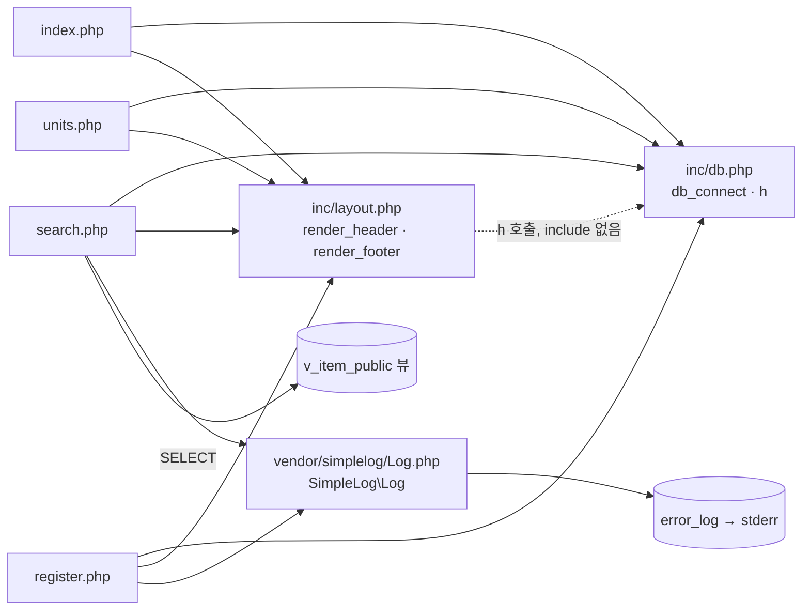

# legacy/item-bank-php 아키텍처 (진입점 · 의존 관계)

> 분석 범위: 진입점과 의존 관계까지. 데이터 흐름 · 비즈니스 규칙은 아직 분석하지 않았다.
> `search.php` 는 1~60행 · 520~731행만 읽었고, 61~519행(`buildSearchQuery` 본문)은 패턴 검색만 했다.
> 근거는 모두 `legacy/item-bank-php/` 기준 상대 경로 `파일:줄번호` 로 적는다.

## 1. 모듈 개요

- PHP 7.4 + Apache 이미지에서 mysqli 로 MariaDB 에 붙는 문항 은행 화면이다 (`Dockerfile:1`, `Dockerfile:3`, `inc/db.php:21`).
- 화면은 홈 · 단원 목록 · 문항 등록 · 문항 검색 4개이고, 각 화면이 PHP 파일 하나다 (`inc/layout.php:9-13`, `index.php:9-11`).
- 파일 8개, 총 1,120줄이며 그중 `search.php` 가 731줄이다.
- 공통 코드는 `inc/db.php`(DB 연결 · `h()`)와 `inc/layout.php`(머리말 · 꼬리말) 두 개다.
- 로그는 외부 라이브러리 `vendor/simplelog/Log.php` 를 통해 `error_log`(stderr)로 남긴다 (`Log.php:52`, `Dockerfile:11`).

## 2. 폴더 구조

```
legacy/item-bank-php/
├── Dockerfile                 16줄  php:7.4-apache, mysqli, 모듈 전체를 /var/www/html/ 로 복사
├── index.php                  14줄  홈 (메뉴)
├── units.php                  48줄  단원 목록
├── register.php              177줄  문항 등록 (폼 + 저장)
├── search.php                731줄  문항 검색 (SQL 조립 · 실행 · HTML 출력)
├── inc/
│   ├── db.php                 37줄  db_connect(), h()
│   └── layout.php             43줄  render_header(), render_footer()
└── vendor/
    └── simplelog/
        └── Log.php            54줄  SimpleLog\Log (외부 라이브러리, "수정하지 말 것" Log.php:3)
```

`.htaccess` · RewriteRule 은 모듈 안에서 찾지 못했다.

## 3. 진입점 표

`Dockerfile:14` 에서 모듈 전체를 `/var/www/html/` 에 복사하고 `.htaccess` 가 없으므로, URL 경로 = PHP 파일 경로로 판단했다. `a2enmod rewrite`(`Dockerfile:4`)는 켜져 있으나 Apache 전역 설정은 **미확인**이다.

| URL / 화면 | 처음 실행되는 파일 | 주요 호출 (근거) |
|---|---|---|
| `/index.php` 홈 | `index.php` | `render_header('홈')` `index.php:5`, `render_footer()` `index.php:14`. DB 호출 없음(`db.php` include만 `index.php:2`) |
| `/units.php` 단원 목록 (GET) | `units.php` | `render_header` `units.php:5`, `db_connect` `units.php:8`, 단원별 공개 문항 수 SQL `$conn->query` `units.php:16-20`, `h()` `units.php:40-43`, `render_footer` `units.php:48` |
| `/register.php` 문항 등록 (GET = 폼 표시) | `register.php` | `db_connect` `register.php:17`, 단원 목록 조회 `register.php:27`, 태그 목록 조회 `register.php:34`, `render_header` `register.php:127`, 폼 출력 `register.php:141-175`, `render_footer` `register.php:177` |
| `/register.php` 문항 등록 (POST = 저장) | `register.php` | 입력 수집 `register.php:40-45` → 검증 `register.php:49-81` → `begin_transaction` `register.php:85` → ID 채번 `register.php:87` → `item` INSERT `register.php:92-101` → `item_tag` INSERT `register.php:104-113` → `commit` `register.php:114` → `Log::info` `register.php:115` / 실패 시 `rollback` · `Log::error` `register.php:120-121` |
| `/search.php` 문항 검색 (GET) | `search.php` | `render_header` `search.php:709`, `db_connect` `search.php:713`, `buildSearchQuery($_GET, $conn)` `search.php:722`, `renderSearchForm` `search.php:723`, `runSearchQuery` `search.php:724`, `renderResultTable` `search.php:725`, 실패 시 `Log::error` `search.php:727`, `render_footer` `search.php:731` |

`search.php` 의 GET 파라미터는 헤더 주석에 `q, unit, level, tag, sort, dir, page` 로 적혀 있다(`search.php:5-12`). 7개 모두 `buildSearchQuery` 에서 꺼낸다(`search.php:53-80`). 처리 규칙은 [BUSINESS-RULES.md](./BUSINESS-RULES.md) §1 · §2 에 있다.

## 4. 의존 관계

### 4.1 흐름도

화살표 방향은 "A → B (A가 B를 포함하거나 호출)" 이다. 점선은 `require_once` 없이 호출하는 암묵적 의존이다.



### 4.2 파일 포함 (`require_once`)

| A → B | 근거 |
|---|---|
| `index.php` → `inc/db.php`, `inc/layout.php` | `index.php:2-3` |
| `units.php` → `inc/db.php`, `inc/layout.php` | `units.php:2-3` |
| `register.php` → `inc/db.php`, `inc/layout.php`, `vendor/simplelog/Log.php` | `register.php:2-4` |
| `search.php` → `inc/db.php`, `inc/layout.php`, `vendor/simplelog/Log.php` | `search.php:20-22` |

`inc/db.php`, `inc/layout.php`, `Log.php` 는 다른 파일을 포함하지 않는다.

### 4.3 호출 표

| A → B | 호출 | 근거 |
|---|---|---|
| `inc/layout.php` → `inc/db.php` | `h()` — `db.php` 를 include 하지 않고, 호출 화면이 먼저 include 한다는 암묵적 순서에 기댄다 | `inc/layout.php:17`, `:33` |
| `index.php` → `inc/layout.php` | `render_header`, `render_footer` | `index.php:5`, `:14` |
| `units.php` → `inc/db.php` | `db_connect`, `h` | `units.php:8`, `:10`, `:40-43` |
| `units.php` → `inc/layout.php` | `render_header`, `render_footer` | `units.php:5`, `:11`, `:48` |
| `register.php` → `inc/db.php` | `db_connect`, `h` | `register.php:17`, `:20`, `:131`, `:136`, `:144`, `:148`, `:155`, `:171` |
| `register.php` → `inc/layout.php` | `render_header`, `render_footer` | `register.php:19`, `:21`, `:127`, `:177` |
| `register.php` → `Log.php` | `Log::info`, `Log::error` | `register.php:115`, `:121` |
| `search.php` → `inc/db.php` | `db_connect`, `h` | `search.php:713`, `:715`, `:674-678`, `:690`, `:696`, `:700` |
| `search.php` → `inc/layout.php` | `render_header`, `render_footer` | `search.php:709`, `:717`, `:731` |
| `search.php` → `Log.php` | `Log::setThreshold` / `Log::debug` / `Log::error` | `search.php:27` / `:103`, `:528` / `:537`, `:727` |
| `Log.php` → PHP 내장 `error_log` | 모든 레벨이 `Log::write` 를 거친다. 출력처는 stderr | `Log.php:43-52`, `Dockerfile:11` |

### 4.4 `search.php` 내부 호출

| A → B | 근거 |
|---|---|
| 최상위 실행부 → `buildSearchQuery` → `renderSearchForm` → `runSearchQuery` → `renderResultTable` (순차 호출) | `search.php:722-725` |
| `buildSearchQuery` → DB 직접 조회: 단원 1건 `prepare` / 단원 목록 `query` / 태그 목록 `query` | `search.php:125` / `:156` / `:178` |
| `buildSearchQuery` 반환 배열(`form_html`, `summary_html`, `warning_html`, `sort_links` 등) → `renderSearchForm`, `renderResultTable` 에서 사용 | `search.php:541-563`, `:631`, `:652-653`, `:662` |
| 검색 · 건수 SQL 의 대상 → 뷰 `v_item_public` (정의는 모듈 안에 없음) | `search.php:522`, `:526` |

## 5. 가장 긴 함수 3개

| 순위 | 파일 | 함수 | 시작~끝 | 줄 수 | 하는 일 |
|---|---|---|---|---|---|
| 1 | `search.php` | `buildSearchQuery` | `:42`~`:564` | 523 | GET 파라미터로 검색 SQL · COUNT SQL · 바인딩 값 · 폼/요약/정렬 링크 HTML 을 한꺼번에 만든다 (`search.php:29-41`, `:541-563`) |
| 2 | `search.php` | `renderResultTable` | `:647`~`:704` | 58 | 건수 · 결과 표 · 페이지 이동 링크를 출력한다. 0건이면 안내 문구만 출력 (`search.php:655-659`) |
| 3 | `search.php` | `runSearchQuery` | `:571`~`:624` | 54 | COUNT 와 목록 쿼리를 prepare → 동적 bind → execute 해서 `total` · `rows` 를 돌려준다 (`search.php:577-623`) |

참고: 그다음은 `render_header`(`inc/layout.php:7-36`, 30줄), `db_connect`(`inc/db.php:7-29`, 23줄)다. `register.php` · `units.php` 에는 함수가 없고 모든 로직이 파일 최상위에 있다.

## 6. 미확인 목록

| 항목 | 현재 알고 있는 것 | 확인할 곳 |
|---|---|---|
| `buildSearchQuery` 본문 세부 | 정렬 · 페이징 · 필터 규칙, `$where` · `$orderBy` 에 붙는 내용은 읽지 않았다 | `search.php:61-519` |
| `buildSearchQuery` 가 만드는 HTML 의 이스케이프 | 이 구간에서 `h()` · `htmlspecialchars` 호출이 검색되지 않았고 `rawurlencode` 만 있다(`search.php:386`, `:415`, `:425`, `:427`). 이 HTML 은 이스케이프 없이 출력된다(`search.php:633-637`, `:652-653`, `:665-669`). 입력값이 그대로 들어가는지는 미확인 | `search.php:61-519` |
| ~~GET 파라미터 `level`, `tag`, `sort`, `dir`, `page` 처리~~ (확인됨) | `search.php:61-80`, `:209-349` 에서 처리한다. 규칙은 BUSINESS-RULES.md BR-03 · BR-10~BR-21 | — |
| ~~뷰 `v_item_public` 정의~~ (확인됨) | 뷰가 `WHERE i.status = 'A'` 로 공개 문항만 거른다(`db/mariadb/init/01-schema.sql:52-70`). BUSINESS-RULES.md BR-02 | — |
| Apache 전역 설정 (rewrite 규칙) | `a2enmod rewrite` 는 켜져 있다(`Dockerfile:4`). 규칙이 있으면 "URL = 파일" 판단이 바뀐다 | 이미지 내부 Apache 설정 |
