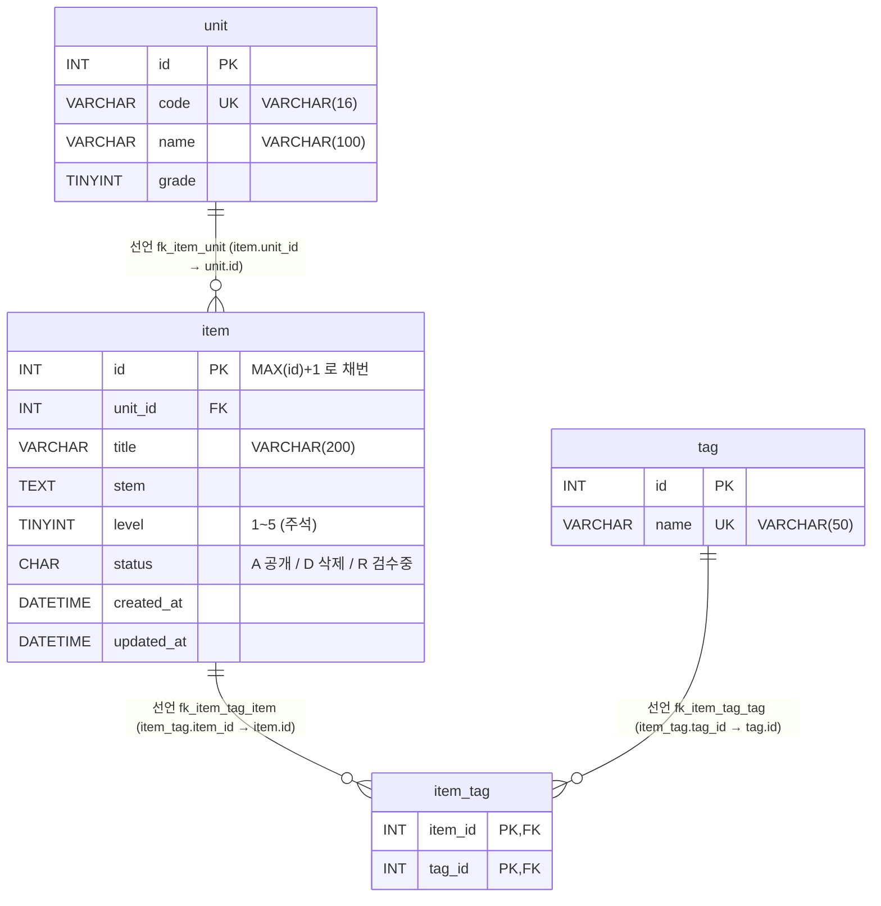

# legacy/item-bank-php 데이터 흐름 (테이블 · 관계 · 읽기/쓰기 위치)

> 선행 문서: [ARCHITECTURE.md](./ARCHITECTURE.md) (진입점 · 의존 관계)
> 분석 범위: `legacy/item-bank-php/` 의 PHP 파일 전체와, 이 모듈이 붙는 DB 의 스키마 · 시드 파일.
> 근거 표기: 모듈 안 파일은 ARCHITECTURE.md 와 같이 `legacy/item-bank-php/` 기준 상대 경로(`register.php:93`),
> 모듈 밖 파일은 저장소 루트 기준 경로(`db/mariadb/init/01-schema.sql:20`)로 적는다.

## 0. 스키마 정의 위치

- 모듈 안에는 스키마 정의(DDL)가 없다. `.sql` 파일도 없다.
- 모듈은 `DB_NAME` 기본값 `itembank` 로 MariaDB 에 붙는다 (`inc/db.php:16`, `docker-compose.yml:43`).
- `itembank` DB 의 DDL 은 `db/mariadb/init/01-schema.sql`, 시드는 `db/mariadb/init/02-seed.sql` 이다.
  compose 가 이 폴더를 MariaDB 초기화 스크립트로 마운트한다 (`docker-compose.yml:25`).
- 같은 DB 에 과제 배포용 테이블(`class`, `assignment`, `distribution`, `submission`)도 있지만
  (`db/mariadb/init/01-schema.sql:72-115`) item-bank-php 코드는 이 테이블들을 읽지도 쓰지도 않는다.
  이 문서에서는 범위 밖으로 둔다. 단, `assignment.unit_id → unit.id` 외래 키(`01-schema.sql:89`)가 있어
  `unit` 행을 지우거나 id 를 바꾸면 과제 쪽에 영향이 있다.

## 1. 테이블 목록

item-bank-php 코드가 직접 또는 뷰를 거쳐 접근하는 테이블 4개와 뷰 1개.

| 테이블 | 주요 컬럼 | 키 · 제약 | 근거 (정의) | 근거 (코드에서 쓰는 SQL) |
|---|---|---|---|---|
| `unit` 단원 | `id` INT, `code` VARCHAR(16), `name` VARCHAR(100), `grade` TINYINT | PK `id`, UNIQUE `code` | `db/mariadb/init/01-schema.sql:11-18` | `units.php:16-19`, `register.php:27`, `search.php:125`, `search.php:156` |
| `item` 문항 | `id` INT, `unit_id` INT, `title` VARCHAR(200), `stem` TEXT, `level` TINYINT(1~5), `status` CHAR(1) 기본 `'A'` (A=공개 D=삭제 R=검수중), `created_at` · `updated_at` DATETIME | PK `id`(AUTO_INCREMENT 아님), FK `unit_id`, 인덱스 `unit_id` · `level` | `01-schema.sql:20-33` | `units.php:17`, `register.php:87`, `register.php:93-94` |
| `tag` 태그 | `id` INT, `name` VARCHAR(50) | PK `id`, UNIQUE `name` | `01-schema.sql:35-40` | `register.php:34`, `search.php:178`, `search.php:244` |
| `item_tag` 문항-태그 연결 | `item_id` INT, `tag_id` INT | PK (`item_id`, `tag_id`), FK 2개 | `01-schema.sql:42-48` | `register.php:105`, `search.php:244-245` |
| `v_item_public` (뷰) | `id`, `unit_id`, `unit_code`, `unit_name`, `unit_grade`, `title`, `stem`, `level`, `created_at`, `updated_at`, `tag_names`(쉼표 구분 태그 이름) | `item JOIN unit` + `item_tag JOIN tag` 서브쿼리, `WHERE i.status = 'A'` | `01-schema.sql:52-70` | `search.php:521-522`, `search.php:526` |

참고
- `item.id` 는 AUTO_INCREMENT 가 아니다(`01-schema.sql:21`). 등록 화면이 `MAX(id)+1` 로 직접 채번한다 (`register.php:87`, `:90`).
- `item.status` 의 값 의미(A · D · R)는 스키마 주석에만 있고 CHECK 제약은 없다 (`01-schema.sql:26`).
- `level` 1~5 범위도 스키마 주석뿐이고(`01-schema.sql:25`), 코드 검증은 `register.php:70`(`/^[1-5]$/`) 에 있다.
- `tag_names` 는 태그 `id` 순으로 `GROUP_CONCAT` 한 문자열이다 (`01-schema.sql:64-67`).

## 2. 테이블 관계



### 2.1 관계 근거

| 관계 | 구분 | 외래 키 근거 | 코드 JOIN · 조건 근거 |
|---|---|---|---|
| `unit` 1 — N `item` | **선언** | `01-schema.sql:32` | `units.php:17` (`i.unit_id = u.id` 상관 서브쿼리), 뷰 `01-schema.sql:69` |
| `item` 1 — N `item_tag` | **선언** | `01-schema.sql:46` | `search.php:245` (`it.item_id = v_item_public.id`), 뷰 `01-schema.sql:67` |
| `tag` 1 — N `item_tag` | **선언** | `01-schema.sql:47` | `search.php:244` (`JOIN tag t ON t.id = it.tag_id`), 뷰 `01-schema.sql:66` |

- 코드의 JOIN · 상관 조건은 모두 선언된 외래 키와 같은 컬럼 쌍이다. **외래 키 없이 JOIN 에서만 추정한 관계는 찾지 못했다.**
- 카디널리티의 "필수" 쪽(`||`)은 FK 컬럼이 `NOT NULL` 인 데서(`01-schema.sql:22`, `:43-44`), "0개 이상" 쪽(`o{`)은 반대 방향 제약이 없는 데서 판단했다.
- 뷰 `v_item_public` 은 테이블이 아니어서 다이어그램에 넣지 않았다. 뷰의 `unit_code` 는 `unit.code` 이고(`01-schema.sql:56`),
  검색 화면은 이 값으로 단원을 필터한 뒤(`search.php:118`) 같은 코드로 `unit` 을 다시 조회한다(`search.php:125`).
- `unit.code` 의 콜레이션은 `utf8mb4_unicode_ci` 다(`01-schema.sql:5`, `:18`). 연결 문자셋도 `utf8mb4` 라서(`inc/db.php:27`)
  두 비교 모두 대소문자를 가리지 않는다. 소문자 `m5-1` 도 `M5-1` 과 일치한다 — 스키마로 판단했고 실행 미확인 (BUSINESS-RULES.md BR-41).

## 3. 읽기 · 쓰기 위치

`units.php`, `register.php` 에는 함수가 없고 모든 코드가 파일 최상위에 있다 (ARCHITECTURE.md §5). 표에서는 "(최상위)" 로 적는다.

### 3.1 `unit`

| 구분 | 파일 · 함수 | SQL 요지 | 근거 |
|---|---|---|---|
| SELECT | `units.php` (최상위) | `id, code, name, grade` + 단원별 공개 문항 수, `ORDER BY grade, code` | `units.php:16-19` |
| SELECT | `register.php` (최상위) | 단원 선택 목록 `id, code, name`, `ORDER BY grade, code`. POST 검증에도 이 목록을 쓴다 | `register.php:27`, `:61-65` |
| SELECT | `search.php` `buildSearchQuery` | 단원 1건 `name, grade WHERE code = ?` (요약 문구용) | `search.php:125` |
| SELECT | `search.php` `buildSearchQuery` | 단원 선택 목록 `code, name, grade`, `ORDER BY grade, code` | `search.php:156` |
| SELECT (간접) | `search.php` `runSearchQuery` | 뷰 `v_item_public` 경유 (`JOIN unit`) | `search.php:577`, `:600` / `01-schema.sql:69` |
| INSERT · UPDATE · DELETE | 없음 | 모듈 안에서 쓰는 곳을 찾지 못했다 | — |

### 3.2 `item`

| 구분 | 파일 · 함수 | SQL 요지 | 근거 |
|---|---|---|---|
| SELECT | `units.php` (최상위) | `COUNT(*) WHERE unit_id = u.id AND status = 'A'` | `units.php:17` |
| SELECT … FOR UPDATE | `register.php` (최상위, POST) | `COALESCE(MAX(id), 0) + 1` 로 새 id 채번 (트랜잭션 안) | `register.php:85`, `:87` |
| **INSERT** | `register.php` (최상위, POST) | `(id, unit_id, title, stem, level, status, created_at, updated_at)`. `status` 는 `'R'`(검수중) 고정, 시각은 `NOW()` | `register.php:92-99` |
| SELECT (간접) | `search.php` `runSearchQuery` | 뷰 `v_item_public` 경유. 건수 SQL · 목록 SQL 두 번 실행 | `search.php:577`, `:600` |
| UPDATE · DELETE | 없음 | 모듈 안에서 찾지 못했다 | — |

`search.php` 가 뷰에 거는 조건은 `buildSearchQuery` 가 만든다.
- 키워드: `title LIKE ? OR stem LIKE ?` (`search.php:98`)
- 단원: `unit_code = ?` (`search.php:118`)
- 난이도: 값이 비면 `level < 5`(난이도 5 제외), 1~5 이면 `level = ?`, 그 밖의 값도 정수로 `level = ?` (`search.php:214-229`)
- 태그: `EXISTS (item_tag JOIN tag … t.name = ?)` (`search.php:244-245`)
- 공개 여부(`status = 'A'`)는 코드가 아니라 뷰 정의에 있다 (`01-schema.sql:70`).
- 조회 컬럼은 `id, title, unit_code, level, tag_names, created_at` 이고 `LIMIT 20 OFFSET n` (`search.php:521-523`).

### 3.3 `tag`

| 구분 | 파일 · 함수 | SQL 요지 | 근거 |
|---|---|---|---|
| SELECT | `register.php` (최상위) | 태그 선택 목록 `id, name ORDER BY id`. POST 에서 넘어온 태그 id 를 이 목록으로 거른다 | `register.php:34`, `:75-81` |
| SELECT | `search.php` `buildSearchQuery` | 태그 선택 목록 `name ORDER BY id` | `search.php:178` |
| SELECT (서브쿼리) | `search.php` `buildSearchQuery` → `runSearchQuery` 실행 | 태그 필터 `JOIN tag t … t.name = ?` | `search.php:244-245` |
| SELECT (간접) | `search.php` `runSearchQuery` | 뷰의 `tag_names` 서브쿼리 | `01-schema.sql:64-67` |
| INSERT · UPDATE · DELETE | 없음 | 모듈 안에서 찾지 못했다 | — |

### 3.4 `item_tag`

| 구분 | 파일 · 함수 | SQL 요지 | 근거 |
|---|---|---|---|
| **INSERT** | `register.php` (최상위, POST) | 검증된 태그마다 `(item_id, tag_id)` 1행. `item` INSERT 와 같은 트랜잭션 | `register.php:104-111`, `:114` |
| SELECT (서브쿼리) | `search.php` `buildSearchQuery` → `runSearchQuery` 실행 | 태그 필터 `EXISTS` | `search.php:244-245` |
| SELECT (간접) | `search.php` `runSearchQuery` | 뷰의 `tag_names` 서브쿼리 | `01-schema.sql:64-67` |
| UPDATE · DELETE | 없음 | 모듈 안에서 찾지 못했다 | — |

### 3.5 모듈 밖에서 쓰는 곳 (참고)

| 파일 | 대상 | 근거 |
|---|---|---|
| `db/mariadb/init/02-seed.sql` | `unit` · `tag` · `item` · `item_tag` INSERT (초기 데이터) | `02-seed.sql:9`, `:19`, `:36`, `:76` |

### 3.6 요약 흐름

```
[등록 POST] register.php ─ SELECT unit, tag (선택 목록 · 검증)
                         ─ BEGIN → SELECT MAX(id)+1 FROM item FOR UPDATE
                                 → INSERT item (status='R') → INSERT item_tag × N → COMMIT
[단원 목록] units.php    ─ SELECT unit + COUNT(item WHERE status='A')
[검색]     search.php    ─ buildSearchQuery: SELECT unit(1건 · 목록), SELECT tag(목록), WHERE 조립
                         ─ runSearchQuery : SELECT COUNT / SELECT … FROM v_item_public(= item ⋈ unit, status='A')
```

## 4. 미확인

| 항목 | 알고 있는 것 | 확인할 곳 |
|---|---|---|
| `item.status` 를 `'R'` → `'A'`(검수 완료) 또는 `'D'`(삭제)로 바꾸는 곳 | 모듈 안에 `UPDATE` 문이 없다. 등록 문구는 "검수 완료 후 검색에 노출"이라고 한다(`register.php:116`) | 다른 시스템 · 운영 절차 · 수동 SQL |
| `item` · `item_tag` 를 지우는 곳 | 모듈 안에 `DELETE` 문이 없다. 삭제는 `status='D'` 로 표현하는 것으로 보이나(`01-schema.sql:26`, `:50`), 값을 바꾸는 코드는 못 찾았다 | 위와 같음 |
| `unit` · `tag` 를 만들고 고치는 곳 | 모듈은 읽기만 한다. 쓰는 곳은 시드 파일뿐이다(`02-seed.sql:9`, `:19`) | 관리 화면 · 운영 절차 |
| `item.updated_at` 의 갱신 규칙 | 등록 시 `NOW()` 로 한 번 넣는다(`register.php:94`). 읽는 곳 · 갱신하는 곳은 모듈 안에 없다 | 위와 같음 |
| 스키마 주석과 코드의 차이 | 뷰 주석은 "검색 화면과 등록 화면이 모두 이 뷰를 기준으로 삼는다"(`01-schema.sql:51`)지만 `register.php` 는 뷰를 참조하지 않는다 | 주석이 가리키는 의도 |
| 운영 DB 스키마와 이 DDL 의 일치 여부 | 저장소의 DDL 은 실습 compose 용이다. 운영 DB 에 추가 컬럼 · 외래 키 · 트리거가 있는지는 모른다 | 운영 DB 스키마 덤프 (접속하지 않고 제공받아 확인) |
